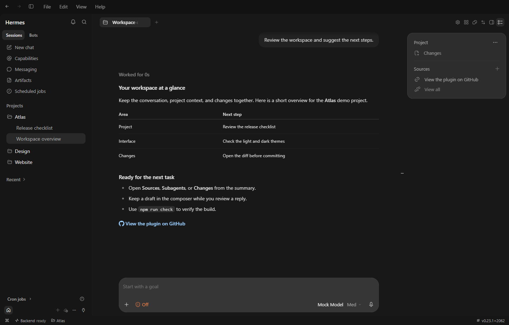
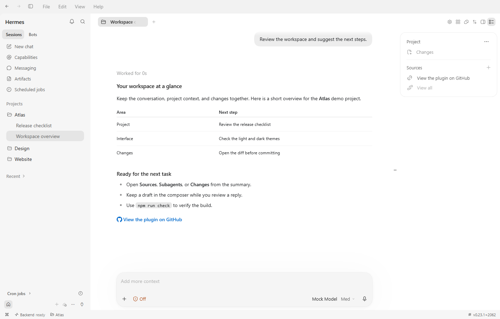
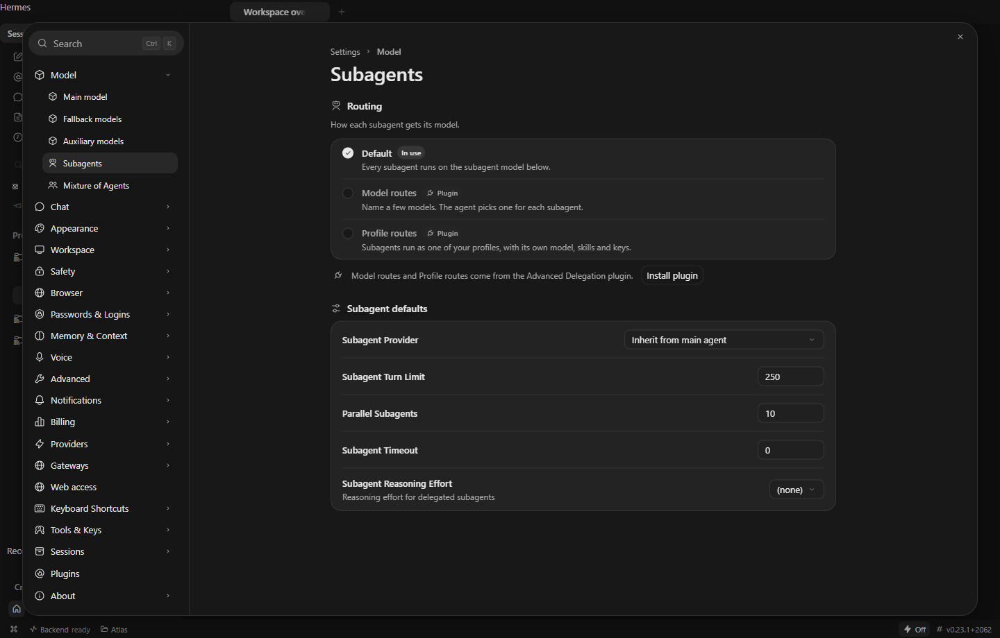
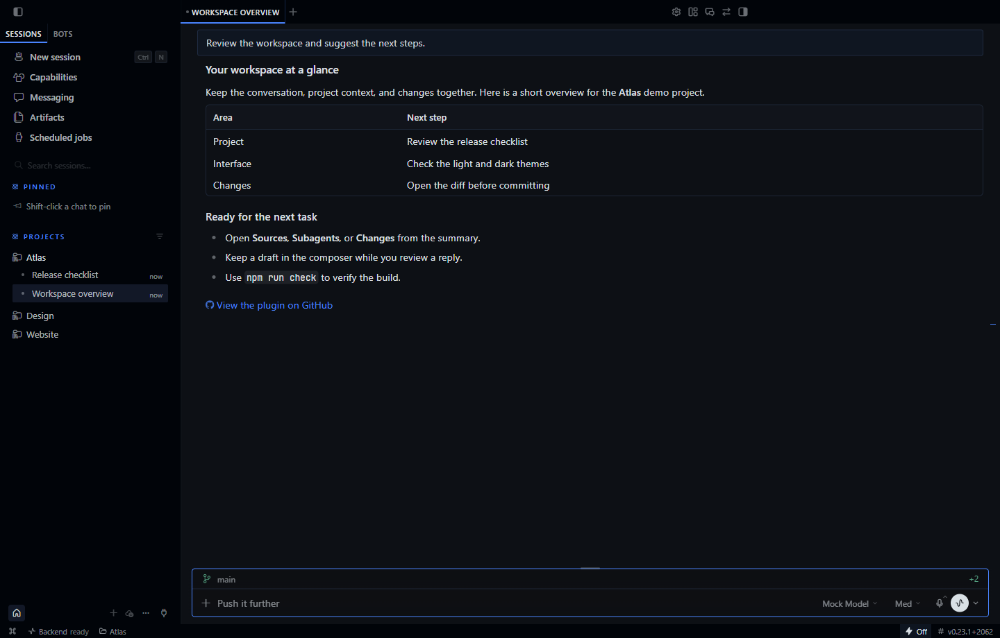

# Hermes Codex Visual

**A Codex-style theme for Hermes Desktop.** Get the compact project sidebar, rounded chat composer, and workspace summary of the Codex desktop interface inside your Hermes Agent workspace.

[Install](#install) · [Download v0.15.135 ZIP](https://raw.githubusercontent.com/arseniy-io/hermes-codex-visual/main/downloads/hermes-codex-visual-v0.15.135.zip) · [Report a bug or request a feature](https://github.com/arseniy-io/hermes-codex-visual/issues/new/choose) · [Русский](README.ru.md)



<sub>v0.15.89 on Hermes Desktop v0.23.1+2062. Public build with the Atlas demo project.</sub>

Version 0.15.135 brings equal-width chat tabs, lighter switching between open chats, quick archiving, and improved activity history. [Release notes](CHANGELOG.md#v015135)

## What you can do

| In the workspace | How it works |
| --- | --- |
| Organize chats | Drag chats to reorder them within a project. Drop a chat into the workspace to link it. Double-click a tab to rename it. |
| Work in the composer | Use the compact composer with your model picker, queued prompts, attachments, and dictation. Open and download files directly from a reply. |
| Read rich replies | Expand tables, copy their contents, and play audio or video without leaving the chat. |
| Review what changed | Open **Changes**, **Subagents**, and **Sources** from the summary. Use the same workspace to open a terminal, choose a branch, or move a chat into a worktree. |
| Switch appearance | Use the light or dark theme across chat, panels, menus, and settings. |

<details>
<summary>See the light theme, settings, and stock workspace</summary>







</details>

## Install

Use [Hermes Desktop](https://hermes-agent.nousresearch.com/docs/user-guide/desktop) with desktop plugin support. Windows is the verified platform for this release.

1. Open **Capabilities → Plugins → Install from Git** and paste this repository URL.
   ```text
   https://github.com/arseniy-io/hermes-codex-visual
   ```
2. Install and enable both the desktop and agent parts. The desktop part applies the theme, and the agent part supplies features such as Activity and Usage.
3. Open **Settings → Appearance → Theme** and select **Codex**.

### Install from a ZIP

Download the ZIP. In **Capabilities → Plugins**, open the app plugins folder and extract the `hermes-codex-visual` folder there. The path should end in `desktop-plugins/hermes-codex-visual/plugin.js`. Click **Rescan**, enable the plugin, and choose **Codex** in Appearance. [Download v0.15.135 ZIP](https://raw.githubusercontent.com/arseniy-io/hermes-codex-visual/main/downloads/hermes-codex-visual-v0.15.135.zip) · [SHA-256 checksums](downloads/SHA256SUMS.txt)

To use Activity, Usage and saved chat history features, install the agent files from the same ZIP. On update, replace both parts with files from the new ZIP, restart the gateway if it already loaded the agent part, and rescan the desktop plugins. [Agent installation and updates](docs/development.md#usage-analytics-in-source-builds)

To switch back, choose a built-in theme and disable the desktop plugin.

## Frequently asked questions

**How do I make Hermes Desktop look like Codex?** Install Hermes Codex Visual, enable its desktop plugin, and select the **Codex** theme in Appearance.

**What runs my chats?** The theme runs in Hermes Desktop. Your workspace uses the Hermes gateway, sessions, and model provider configured in the app.

**Where do I send feedback?** Open an [issue](https://github.com/arseniy-io/hermes-codex-visual/issues/new/choose) with your OS, Hermes version, plugin version, and steps to reproduce. English and Russian are welcome.

## Build and contribute

Use Node.js 22 or newer.

```sh
npm ci
npm run build
npm run check
```

The build writes the root `plugin.js` and the agent files that Hermes installs. [Development notes](docs/development.md)

If this makes Hermes easier for you to use, **star the repository** so you can find it again. Tell us which screen you'd like refined next. [Star on GitHub](https://github.com/arseniy-io/hermes-codex-visual) · [Send feedback](https://github.com/arseniy-io/hermes-codex-visual/issues/new/choose)

Independent community plugin. Codex Desktop is the design reference. [Source-code MIT license](LICENSE) · [Artwork provenance and third-party notices](THIRD_PARTY_NOTICES.txt)
