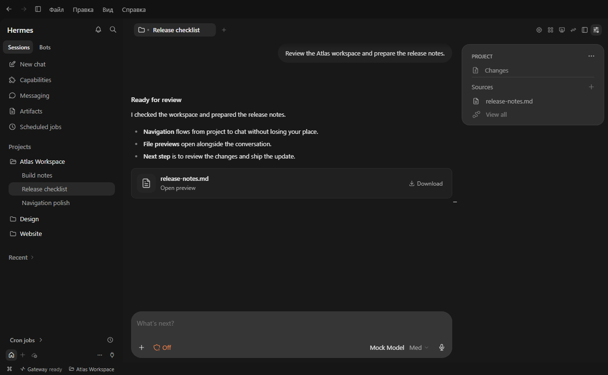
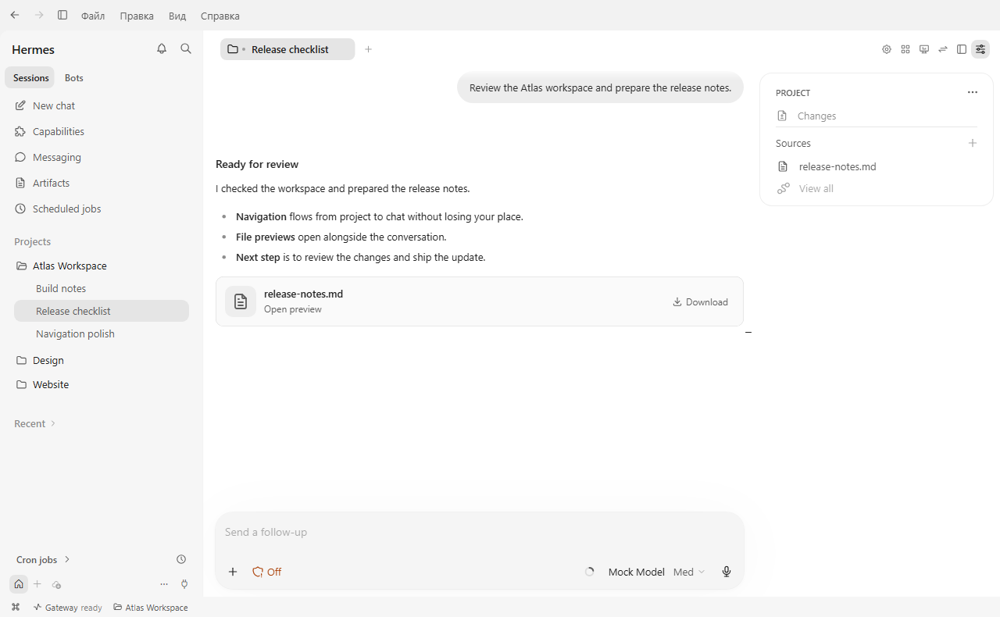
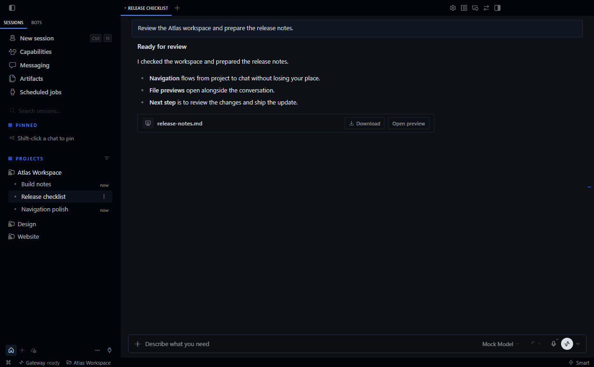

# Hermes Codex Visual

**A Codex-style theme for Hermes Desktop.** Get the compact project sidebar, rounded chat composer, and workspace summary of the Codex desktop interface inside your Hermes Agent workspace.

[Install](#install) · [Download the plugin](https://github.com/arseniy-io/hermes-codex-visual/releases/latest) · [Report a bug or request a feature](https://github.com/arseniy-io/hermes-codex-visual/issues/new/choose) · [Русский](README.ru.md)



<sub>Hermes Desktop with the plugin enabled. The screenshot shows the Atlas demo project.</sub>

## What you can do

| In the workspace | How it works |
| --- | --- |
| Organize chats | Drag chats to reorder them within a project. Drop a chat into the workspace to link it. Double-click a tab to rename it. |
| Work in the composer | Use the compact composer with your model picker, queued prompts, attachments, and dictation. Open and download files directly from a reply. |
| Review what changed | Open **Changes**, **Subagents**, and **Sources** from the summary. Use the same workspace to open a terminal, choose a branch, or move a chat into a worktree. |
| Switch appearance | Use the light or dark theme across chat, panels, menus, and settings. |

<details>
<summary>See the light theme and compare with the stock workspace</summary>





</details>

## Install

Use [Hermes Desktop](https://hermes-agent.nousresearch.com/docs/user-guide/desktop) with desktop plugin support. Windows is the verified platform for this release.

1. Open **Capabilities → Plugins → Install from Git** and paste this repository URL.
   ```text
   https://github.com/arseniy-io/hermes-codex-visual
   ```
2. Select the desktop plugin in the installer. Enable **Hermes Codex Visual** in the plugins list.
3. Open **Settings → Appearance → Theme** and select **Codex**.

### Install from a ZIP

Download `hermes-codex-visual-v0.15.29.zip` from [Releases](https://github.com/arseniy-io/hermes-codex-visual/releases/latest). In **Capabilities → Plugins**, open the app plugins folder and extract the `hermes-codex-visual` folder there. The path should end in `desktop-plugins/hermes-codex-visual/plugin.js`. Click **Rescan**, enable the plugin, and choose **Codex** in Appearance.

To update a ZIP installation, replace `plugin.js` in the same folder and rescan. To switch back, choose a built-in theme and disable the plugin.

## Frequently asked questions

**How do I make Hermes Desktop look like Codex?** Install Hermes Codex Visual, enable its desktop plugin, and select the **Codex** theme in Appearance.

**What runs my chats?** The theme runs in Hermes Desktop. Your workspace uses the Hermes gateway, sessions, and model provider configured in the app.

**Where do I send feedback?** Open an [issue](https://github.com/arseniy-io/hermes-codex-visual/issues/new/choose) with your OS, Hermes version, plugin version, and steps to reproduce. English and Russian are welcome.

## Build and contribute

Use Node.js 22 or newer.

```sh
npm ci
npm run build
npm run check
```

The build writes the root `plugin.js` that Hermes installs. See [the development notes](docs/development.md) for loading a local build and testing changes.

If this makes Hermes easier for you to use, **star the repository** so you can find it again. Tell us which screen you'd like refined next. [Star on GitHub](https://github.com/arseniy-io/hermes-codex-visual) · [Send feedback](https://github.com/arseniy-io/hermes-codex-visual/issues/new/choose)

Independent community plugin. Codex Desktop is the design reference. [MIT license](LICENSE) · [Tabler Icons attribution](THIRD_PARTY_NOTICES.txt)
