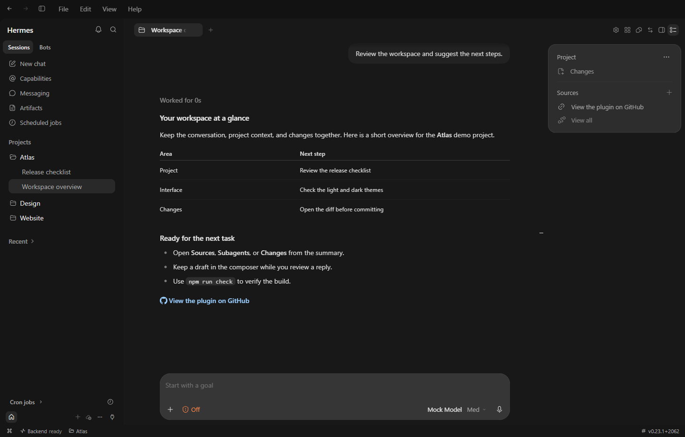
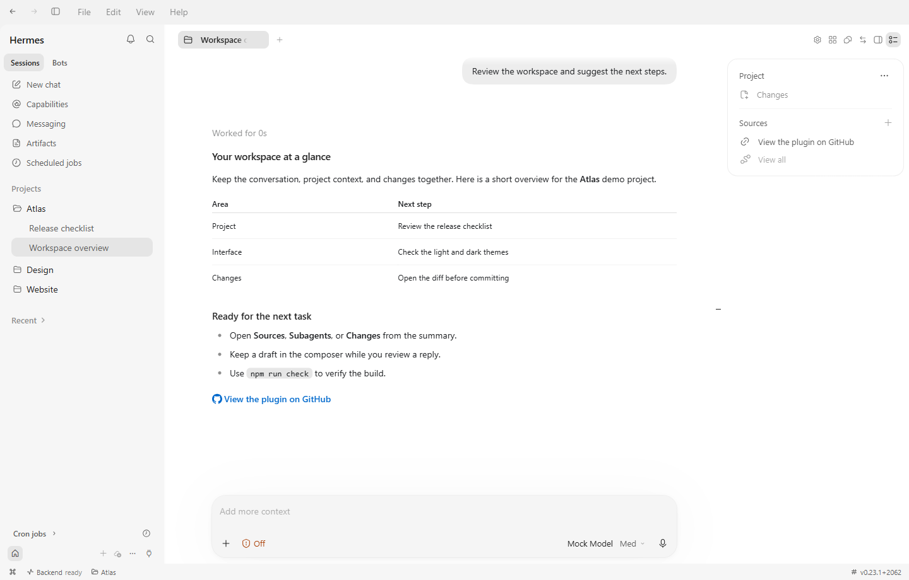
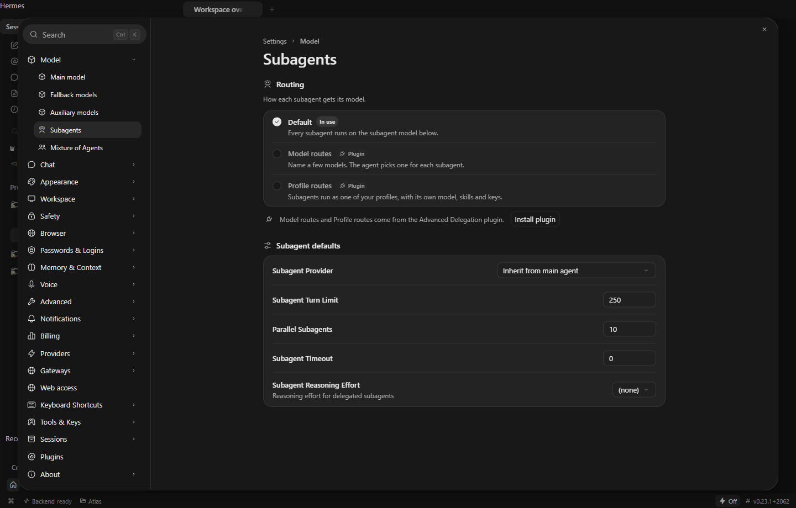
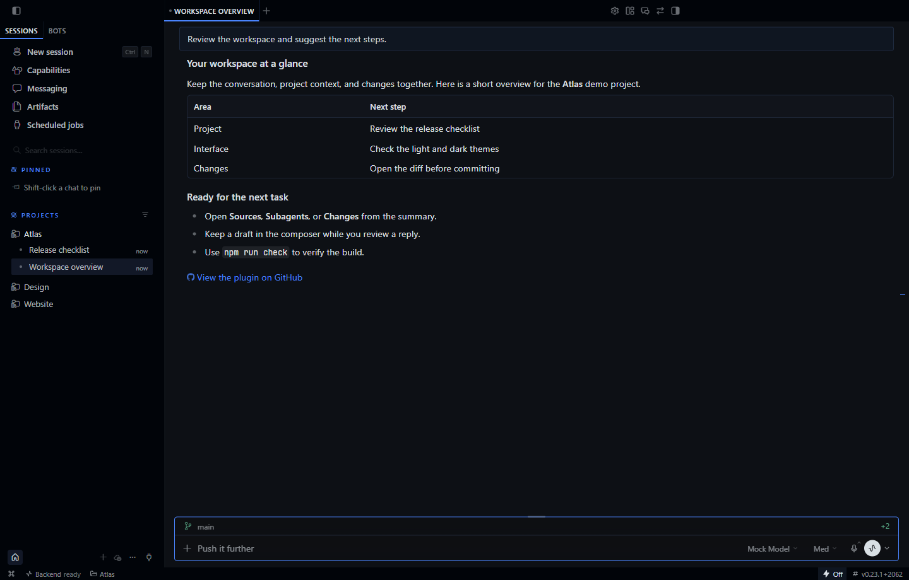

# Hermes Codex Visual

**Тема в стиле Codex для Hermes Desktop.** Компактная боковая панель проектов, скруглённое поле ввода и сводка чата работают прямо в Hermes Agent.

[Установка](#установка) · [Скачать ZIP v0.15.135](https://raw.githubusercontent.com/arseniy-io/hermes-codex-visual/main/downloads/hermes-codex-visual-v0.15.135.zip) · [Сообщить об ошибке или предложить идею](https://github.com/arseniy-io/hermes-codex-visual/issues/new/choose) · [English](README.md)



<sub>v0.15.89 в Hermes Desktop v0.23.1+2062. Публичная сборка с демонстрационным проектом Atlas.</sub>

В версии 0.15.135 вкладки чатов одной ширины. Переключение между ними требует меньше работы от приложения. В боковой панели появились быстрый архив и показ дополнительных чатов проекта. [Что вошло в выпуск](CHANGELOG.md#v015135)

## Что можно делать

| В рабочей области | Как это устроено |
| --- | --- |
| Наводить порядок в чатах | Перетаскивай чаты внутри проекта. Чтобы связать чат с открытой рабочей областью, перетащи его туда. Вкладка переименовывается двойным щелчком. |
| Работать с ответами и черновиками | Пользуйся выбором модели, очередью сообщений, вложениями и диктовкой в компактном поле ввода. Файлы можно открывать и скачивать прямо из ответа. |
| Читать ответы с таблицами и медиа | Раскрывай таблицы, копируй их содержимое, слушай аудио и смотри видео прямо в чате. |
| Проверять работу агента | Открывай «Изменения», «Субагенты» и «Источники» из сводки. Оттуда же доступны ветка, терминал и перенос в рабочее дерево. |
| Выбирать светлую или тёмную тему | Оформление применяется к чатам, панелям, меню и настройкам. |

<details>
<summary>Светлая тема, настройки и исходный интерфейс Hermes для сравнения</summary>







</details>

## Установка

Понадобится [Hermes Desktop](https://hermes-agent.nousresearch.com/docs/user-guide/desktop) с поддержкой плагинов интерфейса. Выпуск проверен на Windows.

1. Открой «Возможности → Плагины → Установить из Git» и вставь адрес репозитория.
   ```text
   https://github.com/arseniy-io/hermes-codex-visual
   ```
2. Установи и включи обе части плагина. Первая отвечает за оформление, вторая подключает «Активность», «Использование» и другие функции, которым нужны данные Hermes.
3. Открой «Настройки → Внешний вид → Тема» и выбери **Codex**.

### Установка из ZIP

Скачай ZIP. В «Возможности → Плагины» открой папку плагинов приложения и распакуй туда папку `hermes-codex-visual`. Путь должен заканчиваться на `desktop-plugins/hermes-codex-visual/plugin.js`. Нажми «Пересканировать», включи плагин и выбери **Codex** во «Внешнем виде». [Скачать ZIP v0.15.135](https://raw.githubusercontent.com/arseniy-io/hermes-codex-visual/main/downloads/hermes-codex-visual-v0.15.135.zip) · [Контрольные суммы SHA-256](downloads/SHA256SUMS.txt)

Для «Активности», «Использования» и функций сохранённой истории установи файлы агентской части из того же ZIP. При обновлении замени обе части файлами из нового ZIP. Если шлюз уже загрузил агентскую часть, штатно перезапусти его. Затем пересканируй плагины интерфейса. [Установка и обновление агентской части](docs/development.md#usage-analytics-in-source-builds)

Чтобы вернуться к обычному виду, выбери штатную тему и выключи плагин интерфейса.

## Частые вопросы

**Как сделать интерфейс Hermes Desktop похожим на Codex?** Установи Hermes Codex Visual, включи плагин интерфейса и выбери тему **Codex** во «Внешнем виде».

**Где работают мои чаты?** Тема работает в Hermes Desktop. Для чатов используется настроенный в Hermes шлюз и выбранная модель.

**Куда отправить отзыв?** Создай [задачу на GitHub](https://github.com/arseniy-io/hermes-codex-visual/issues/new/choose). Укажи систему, версии Hermes и плагина, а также шаги, на которых возникла проблема. Можно писать по-русски.

## Сборка

Нужен Node.js 22 или новее.

```sh
npm ci
npm run build
npm run check
```

Сборка создаёт `plugin.js` в корне проекта. Этот файл загружает Hermes. [Как проверить локальную сборку](docs/development.md#проверка-в-hermes)

Если с плагином работать удобнее, **поставь звезду** на GitHub, чтобы сохранить проект под рукой. Если какой-то экран ещё хочется улучшить, напиши какой. [Поставить звезду](https://github.com/arseniy-io/hermes-codex-visual) · [Оставить отзыв](https://github.com/arseniy-io/hermes-codex-visual/issues/new/choose)

Независимый плагин сообщества. Визуальный ориентир - Codex Desktop. [MIT для исходного кода](LICENSE) · [Происхождение значков и сторонние лицензии](THIRD_PARTY_NOTICES.txt)
