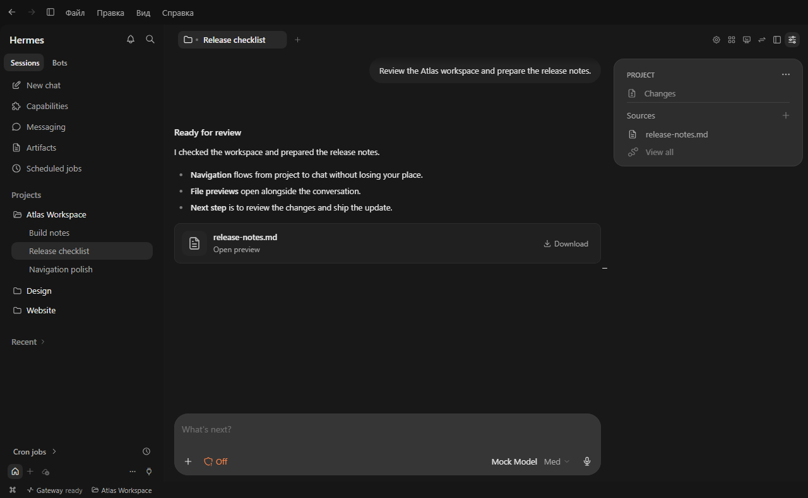
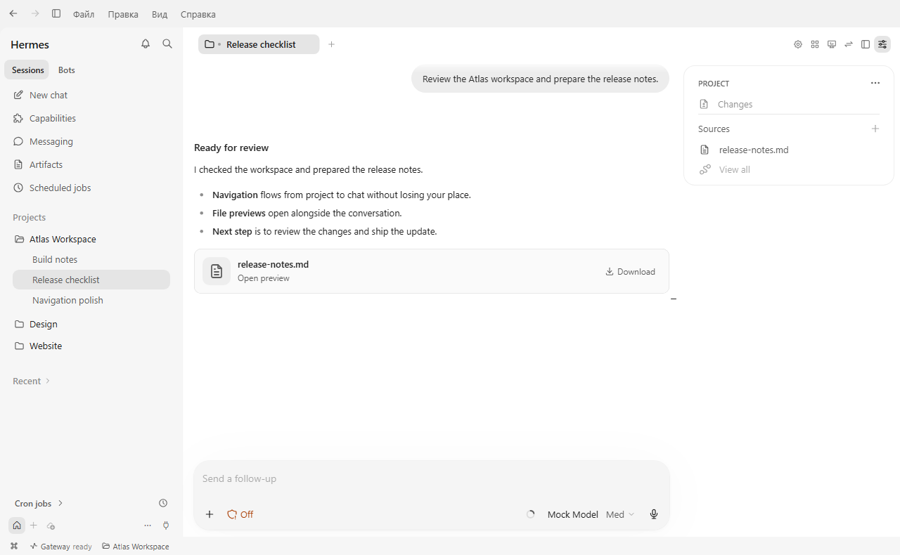
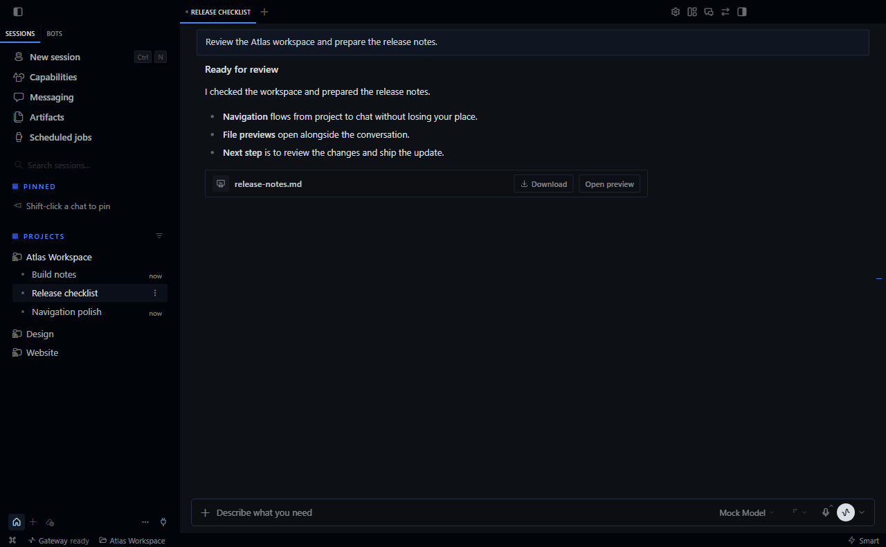

# Hermes Codex Visual

**Тема в стиле Codex для Hermes Desktop.** Компактная боковая панель проектов, скруглённое поле ввода и сводка чата работают прямо в Hermes Agent.

[Установка](#установка) · [Скачать ZIP v0.15.46](https://raw.githubusercontent.com/arseniy-io/hermes-codex-visual/main/downloads/hermes-codex-visual-v0.15.46.zip) · [Сообщить об ошибке или предложить идею](https://github.com/arseniy-io/hermes-codex-visual/issues/new/choose) · [English](README.md)



<sub>Скриншот Hermes Desktop с включённым плагином и демонстрационным проектом Atlas.</sub>

## Что можно делать

| В рабочей области | Как это устроено |
| --- | --- |
| Наводить порядок в чатах | Перетаскивай чаты внутри проекта. Чтобы связать чат с открытой рабочей областью, перетащи его туда. Вкладка переименовывается двойным щелчком. |
| Работать с ответами и черновиками | Пользуйся выбором модели, очередью сообщений, вложениями и диктовкой в компактном поле ввода. Файлы можно открывать и скачивать прямо из ответа. |
| Проверять работу агента | Открывай «Изменения», «Субагенты» и «Источники» из сводки. Оттуда же доступны ветка, терминал и перенос в рабочее дерево. |
| Выбирать светлую или тёмную тему | Оформление применяется к чатам, панелям, меню и настройкам. |

<details>
<summary>Светлая тема и исходный интерфейс Hermes для сравнения</summary>





</details>

## Установка

Понадобится [Hermes Desktop](https://hermes-agent.nousresearch.com/docs/user-guide/desktop) с поддержкой плагинов интерфейса. Выпуск проверен на Windows.

1. Открой «Возможности → Плагины → Установить из Git» и вставь адрес репозитория.
   ```text
   https://github.com/arseniy-io/hermes-codex-visual
   ```
2. Выбери установку плагина интерфейса и включи **Hermes Codex Visual** в списке плагинов.
3. Открой «Настройки → Внешний вид → Тема» и выбери **Codex**.

### Установка из ZIP

Скачай [ZIP v0.15.46](https://raw.githubusercontent.com/arseniy-io/hermes-codex-visual/main/downloads/hermes-codex-visual-v0.15.46.zip). В «Возможности → Плагины» открой папку плагинов приложения и распакуй туда папку `hermes-codex-visual`. Путь должен заканчиваться на `desktop-plugins/hermes-codex-visual/plugin.js`. Нажми «Пересканировать», включи плагин и выбери **Codex** во «Внешнем виде». [Контрольные суммы SHA-256](downloads/SHA256SUMS.txt) · [Что вошло в версию](CHANGELOG.md)

Чтобы обновить версию из ZIP, замени `plugin.js` в той же папке и запусти пересканирование. Чтобы вернуться к обычному виду, выбери штатную тему и выключи плагин.

## Частые вопросы

**Как сделать интерфейс Hermes Desktop похожим на Codex?** Установи Hermes Codex Visual, включи плагин интерфейса и выбери тему **Codex** во «Внешнем виде».

**Где работают мои чаты?** Тема работает в Hermes Desktop. Для чатов используется настроенный в Hermes шлюз и выбранная модель.

**Куда отправить отзыв?** Создай [задачу на GitHub](https://github.com/arseniy-io/hermes-codex-visual/issues/new/choose). Укажи систему, версии Hermes и плагина, а также шаги, на которых возникла проблема. Можно писать по-русски.

## Сборка

Нужен Node.js 22 или новее.

```sh
npm ci
npm run build
npm run check
```

Сборка создаёт `plugin.js` в корне проекта. Этот файл загружает Hermes. [Как проверить локальную сборку](docs/development.md#проверка-в-hermes)

Если с плагином работать удобнее, **поставь звезду** на GitHub, чтобы сохранить проект под рукой. Если какой-то экран ещё хочется улучшить, напиши какой. [Поставить звезду](https://github.com/arseniy-io/hermes-codex-visual) · [Оставить отзыв](https://github.com/arseniy-io/hermes-codex-visual/issues/new/choose)

Независимый плагин сообщества. Визуальный ориентир - Codex Desktop. [Лицензия MIT](LICENSE) · [Лицензия значков Tabler](THIRD_PARTY_NOTICES.txt)
